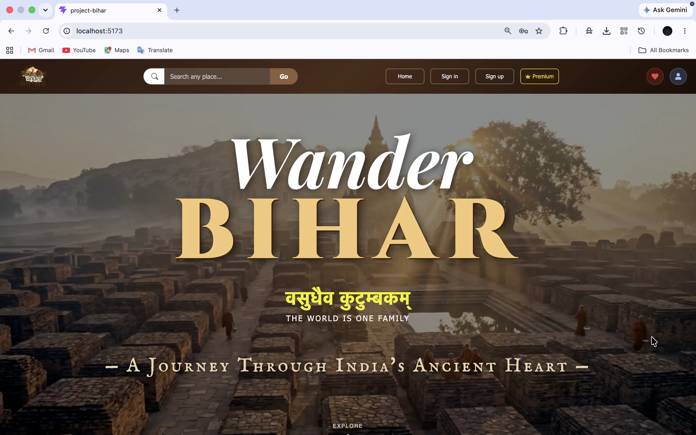
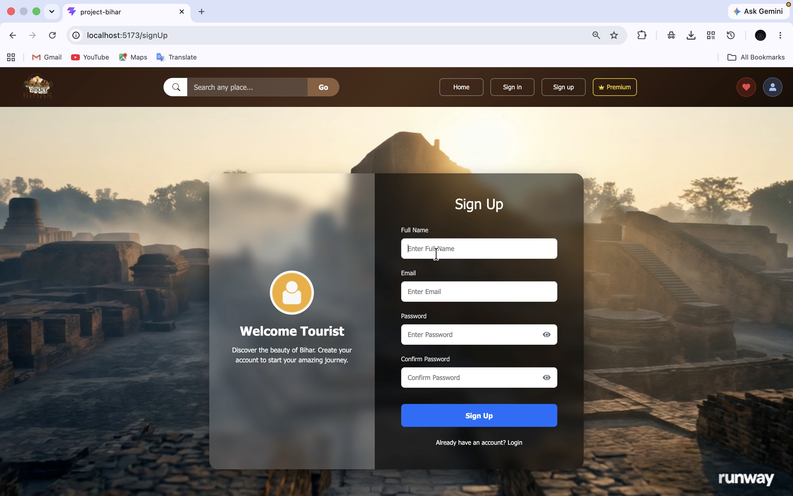
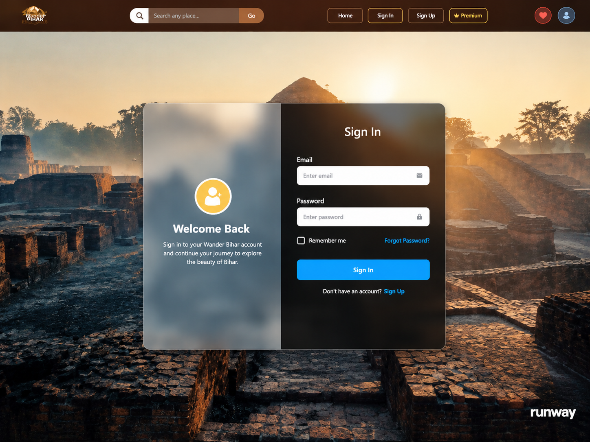
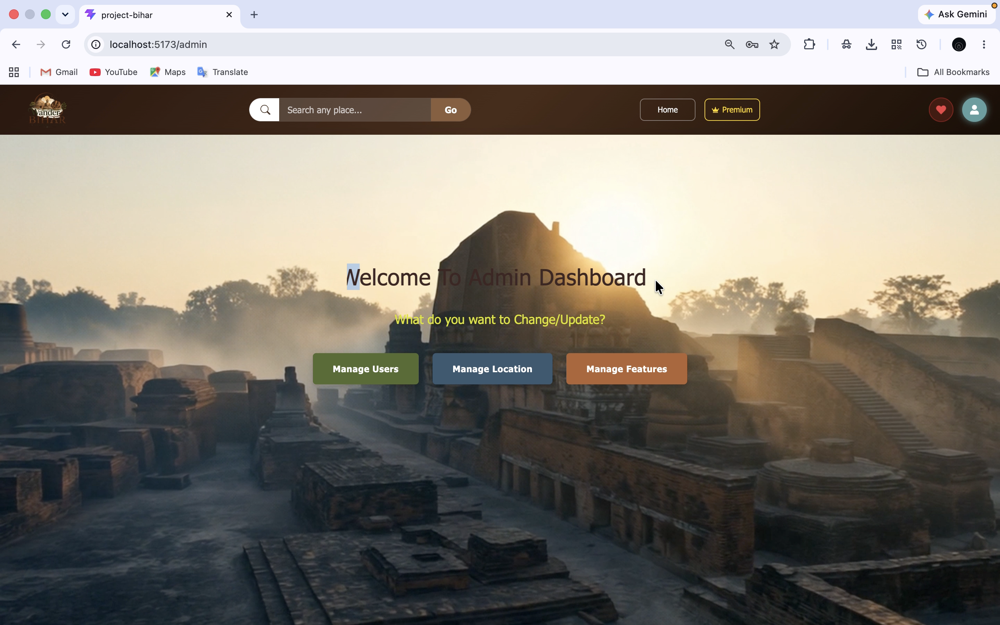

## 🌍 Wander Bihar — Full Stack Tourism Platform

A MERN Stack-based full-stack tourism platform designed to showcase Bihar’s rich cultural heritage and historical destinations through a dynamic and user-friendly interface. The application features secure user authentication, destination browsing, wishlist management, premium subscription services, and an integrated admin dashboard for managing tourism content. Developed as part of the Short-Term Industrial Training in Full Stack Development using MERN Stack at C-DAC Patna (ACTS).


## 🎯 Project Vision & Problem Statement

The Challenge: Existing government tourism portals are often static, disconnected, and offer limited personalization. They primarily provide general information without dedicated, personalized spaces for users.

The Solution: Wander Bihar connects Bihar’s rich historical heritage with modern web technology. It transforms traditional tourism browsing into an interactive and personalized experience through user profiles, dynamic database-driven content, and responsive user interfaces. By bringing tourism information, travel resources, and interactive features together on a single platform, it reduces the need to search across multiple websites.

## 📌 Project Highlights

- 🔐 Secure User Access: JWT-based authentication provides secure login and personalized user sessions.
- 🗺️ Adaptive Interface: The platform dynamically displays user-specific features after successful authentication.
- ❤️ Smart Wishlist: Centralized state management enables tourists to save and organize their preferred destinations for future visits.
- 👑 Premium Membership: A simulated subscription system demonstrates the foundation for future payment integration and monetization.
- 🛠️ Admin Management Panel: A centralized dashboard enables efficient management of users, tourism locations, and platform content.
- 📱 Responsive User Experience: A modern, mobile-friendly interface combines engaging visuals with smooth navigation across different devices.


## 🏫 Training Details
| Detail | Info |
|---|---|
| Institute | Centre for Development of Advanced Computing (C-DAC), Patna |
| Program | Advanced Computing Training School (ACTS) — Short-Term Training |
| Course | Full Stack Development using MERN Stack |
| Duration | 8th June 2026 – 10th July 2026 (5 Weeks) |
| Result | Grade A |
| Certificate No. | C-DAC/PAT/2606/16017 |
| PRN | 2606807016017 |
| Registration No. | 23105125031 |
| Candidate Name | Pallavi Bharti |


## 🚀 System Architecture & Technology Stack

Frontend

- React.js: Builds a dynamic, component-based user interface, ensuring smooth navigation and an interactive Single Page Application (SPA) experience.
- HTML5, CSS3 & Bootstrap: Provide the structural foundation, visual styling, and responsive layouts across different devices.
- Context API: Manages shared application state and keeps wishlist data synchronized across components.

Backend

- Node.js: Powers server-side operations using an efficient, event-driven JavaScript runtime.
- Express.js: Handles backend routing and RESTful API development, enabling seamless communication between the frontend and database.
- Security: JWT-based authentication manages secure user access, while Bcrypt.js hashes passwords to protect user credentials.

Database

MongoDB: Stores and organizes application data, including user accounts, tourism destinations, and personalized wishlist information in a flexible NoSQL document   structure.

## ⚙️ TECHNICAL BREAKDOWN OF CRUD OPERATIONS 

The four core CRUD operations that manage data and support the functionality of the Wander Bihar tourism platform.

| CRUD Operation | System Action | Frontend/Backend Mechanism |
|---|---|---|
| Create | User Registration, Add Tourist Locations, Add Wishlist Items | POST requests submit user and location data to the backend for storage in MongoDB collections. |
| Read | Display Tourist Places and User Information | GET requests retrieve tourism destinations and user details from the database for display in the interface. |
| Update | Edit Tourist Locations, Premium Plans, and User Details | PUT/PATCH requests modify existing records in MongoDB through backend API endpoints. |
| Delete | Remove Tourist Locations, Wishlist Items, and Users | DELETE requests remove selected records or wishlist entries from the database. |

## ✨ Features

👤 User Features

- Secure Registration: Provides a secure authentication system for users to create accounts and access their personalized profiles.
 
-Login
 
- Browse Tourist Destinations: Enables users to discover Bihar’s famous tourist attractions through an organized and user-friendly interface.
- Explore Bihar Divisions: Displays tourist destinations categorized by divisions, making regional exploration easier.
- Tourist Place Details: Presents relevant information about tourist destinations to help users explore Bihar’s cultural and historical heritage.
- Wishlist Management: Allows users to save and manage their favorite destinations for future visits using `WishlistContext` and `LocalStorage`.
- Premium Tourist Places: Provides access to exclusive destinations and features through a simulated premium subscription system.
- Responsive Design: Ensures a smooth browsing experience across desktops, tablets, and mobile devices.
- Virtual Tour Support: Supports virtual exploration of tourist sites through immersive tour features.

🛠️ Admin Features

- Admin Dashboard: Provides a centralized interface for monitoring and managing the platform.
- User Management: Enables administrators to view, update, and remove registered user accounts.
- Tourist Location Management: Supports adding new destinations, editing existing details, viewing listings, and removing locations through CRUD operations.
- Premium Feature Management: Allows administrators to manage premium features and control their availability.
- Premium Plan Management: Enables administrators to maintain and update premium subscription plans.
- Complete CRUD Operations: Supports creating, reading, updating, and deleting records across relevant management modules.
- Platform Monitoring: Helps administrators oversee tourism content, user information, and essential platform activities.
-  


## 🔭 Future Scope & Scalability

Wander Bihar can be further enhanced by integrating advanced technologies and user-friendly services:

- AI-Based Travel Recommendations: Suggest destinations based on users’ interests and travel preferences.
- Google Maps Integration: Provide interactive maps, navigation, and directions to tourist attractions.
- Hotel & Transport Booking: Enable users to explore and book accommodation and transportation services.
- Online Ticket Booking: Integrate digital ticketing facilities for monuments and tourist attractions.
- AI-Powered Chatbot: Offer instant assistance for tourism-related queries and destination information.
- AR Heritage Experience: Use augmented reality to display virtual reconstructions of historical monuments.
- Voice Navigation: Support voice-guided directions for convenient and accessible travel.
- Reviews & Ratings: Allow tourists to share experiences and rate destinations.
- Multilingual Support: Make tourism information available in multiple regional and international languages.
- Smart Trip Planner: Generate personalized itineraries based on travel duration, interests, and selected destinations.


## 📁 Folder Structure

```text
WANDER_BIHAR/
│
├── BACKEND/
│   ├── config/              # Database connection configuration
│   ├── controllers/         # Business logic (auth, location, payment, premium)
│   ├── middlewares/         # JWT auth & admin role verification
│   ├── models/              # Mongoose schemas
│   ├── routes/              # Express route definitions
│   ├── index.js             # Entry point / server setup
│   └── package.json
│
└── FRONTEND/
    ├── src/
    │   ├── admin/           # Admin dashboard pages 
    │   ├── Premium/         # Premium landing, plans, and payment pages
    │   ├── UserLogin/       # Login, Forgot Password
    │   ├── UserDashboard/   # Logged-in user dashboard & wishlist page
    │   ├── App.jsx          # Route definitions
    │   ├── WishlistContext.jsx # Global wishlist state (Context API)
    │   └── main.jsx
    └── package.json

```
## ⚙️ Installation & Setup

## 1. Clone Repository

```bash
git clone https://github.com/Pallavi9976/Wander_Bihar.git
cd Wander_Bihar
```

---

## 2. Backend Setup

```bash
cd backend
npm install
```

Create a `.env` file inside the backend folder.

```env
PORT=3000
JWT_SECRET=your_secret_key
MONGO_URI=your_mongodb_connection_string
```

Start the backend server.

```bash
npm start
```

---

## 3. Frontend Setup

Open a new terminal.

```bash
cd frontend
npm install
npm run dev
```

---

## 4. Open Application

```
http://localhost:5173
```

Register a new account or log in using existing credentials.

## 👩‍💻 Developer

Pallavi Bharti
Registration No.:-23105125031
PRN:-2606807016017
B.Tech – Computer Science & Engineering


## 🙏 Acknowledgements & Team

We sincerely thank our C-DAC mentors, Ms. Neha Giri and Mr. Aniket, for their valuable guidance and support in developing Wander Bihar. We also appreciate our team members for their collaboration and contributions to the successful completion of this project.

The Development Team (C-DAC Patna Interns):

- Harshit Kashyap — Team Leader
- Pallavi Bharti — Full Stack Developer
- Shiksha — Developer
- Rashmi — Developer
- Anjali — Developer

 ## 📄 License

Wander Bihar was developed as part of an industrial training program for educational purposes. The source code is available for learning, exploration, and academic reference.

